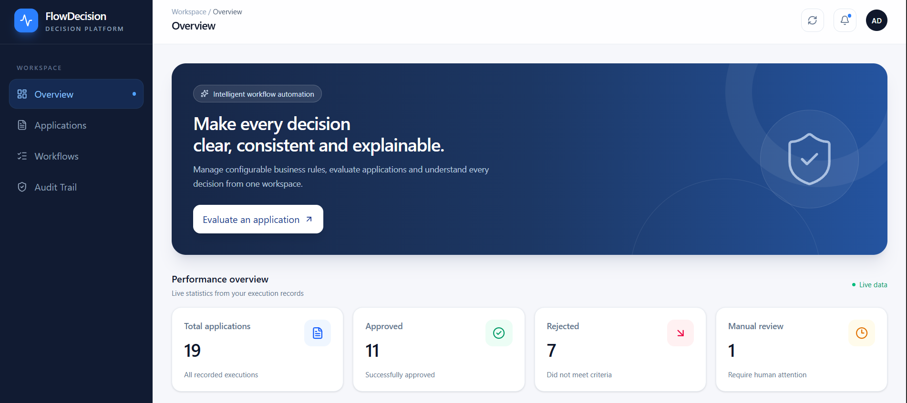
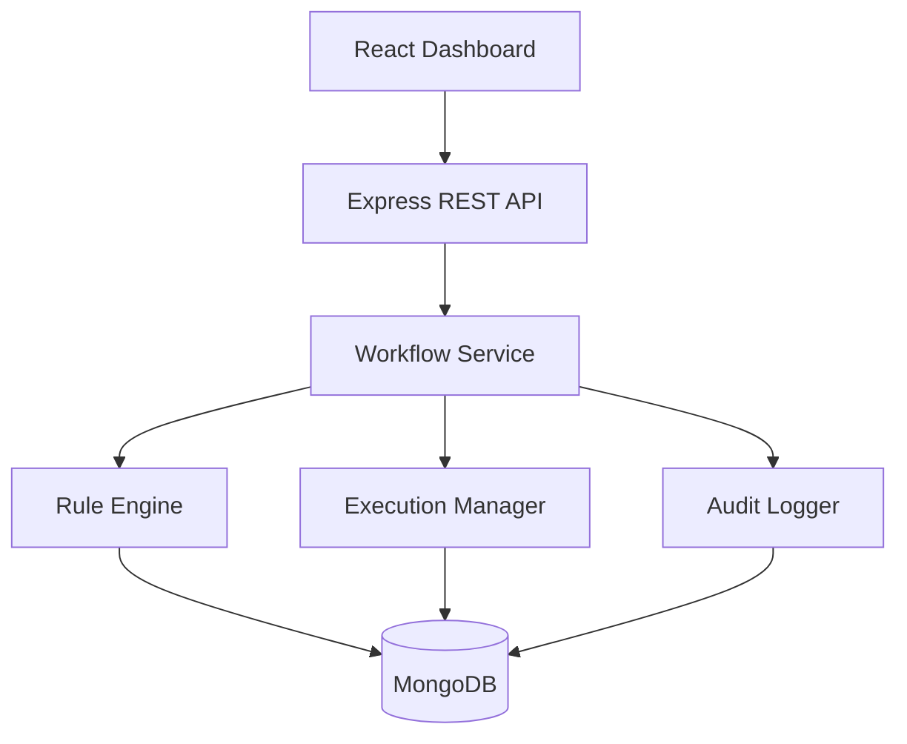

# FlowDecision – Configurable Workflow Decision Platform

A rule-driven workflow automation platform that enables businesses to configure decision rules, execute multi-stage workflows, and generate explainable, auditable decisions.

## 📸 Dashboard Preview

<p align="center">
  
</p>

<p align="center">
  <em>FlowDecision – Workflow Decision Dashboard</em>
</p>

## 🚀 Key Features

- **Configurable Rule Engine:** Evaluate business rules dynamically without changing application code.
- **Workflow Execution:** Execute ordered workflow stages with conditional branching.
- **Decision Management:** Generate APPROVED, REJECTED, and MANUAL_REVIEW outcomes.
- **Explainable Decisions:** Store rule-level results and explanations for every execution.
- **Audit Trail:** Track execution events, completed stages, skipped stages, and failures.
- **Idempotency:** Prevent duplicate completed executions using idempotency keys.
- **Retry Handling:** Retry failed workflow executions using their original configuration snapshot.
- **Interactive Dashboard:** Manage workflows, submit applications, and review execution history.

## 🏗️ Architecture

Built using a modular monolithic architecture.



## 🛠️ Tech Stack

| Layer | Technologies |
|---|---|
| Frontend | React.js, Vite, Tailwind CSS |
| Backend | Node.js, Express.js |
| Database | MongoDB, Mongoose |
| API | REST, Axios |
| Testing | Jest, Supertest |

## 💡 Demonstration: Personal Loan Approval

The platform includes a configurable loan approval workflow based on:

| Rule | Condition | Failure Outcome |
|---|---|---|
| AGE001 | Age >= 21 | REJECTED |
| INCOME001 | Monthly income >= ₹25,000 | REJECTED |
| DOC001 | Documents verified | MANUAL_REVIEW |

**Workflow stages:**
1. Eligibility Check
2. Document Verification
3. Final Decision

If an application is rejected during eligibility checking, document verification is skipped.

## 🔌 API Endpoints

| Method | Endpoint | Description |
|---|---|---|
| GET | `/api/workflows` | Retrieve workflows |
| POST | `/api/workflows` | Create workflow |
| PUT | `/api/workflows/:id` | Update workflow |
| POST | `/api/executions` | Submit application |
| GET | `/api/executions` | View execution history |
| GET | `/api/executions/:id` | View execution details |
| GET | `/api/executions/:id/audit` | View audit history |
| POST | `/api/executions/:id/retry` | Retry failed execution |

## ⚙️ Getting Started

**Prerequisites:** Node.js, npm, and MongoDB.

**1. Clone the repository**
```bash
git clone YOUR_GITHUB_REPOSITORY_URL
cd ScoreMe-FlowDecision
```

**2. Set up the backend**
```bash
cd server
npm install
```

Create `server/.env`:

```env
PORT=5000
MONGODB_URI=your_mongodb_connection_string
CLIENT_URL=http://localhost:5173
```

Seed the sample workflow and start the backend:

```bash
node src/seed.js
npm run dev
```

**3. Set up the frontend** (in a new terminal)

```bash
cd client
npm install
npm run dev
```

Open `http://localhost:5173`.

## 🧪 Testing

Run backend tests:

```bash
cd server
npm test
```

**Current test results:**
- 2 test suites passed
- 13 tests passed

Includes rule-engine unit tests and API validation/integration tests.

## 📌 Engineering Decisions

- **Modular Monolith:** Keeps components separated without unnecessary microservice complexity.
- **Configuration-driven Rules:** Separates business policies from application logic.
- **Execution Snapshots:** Preserve the workflow configuration used for each decision.
- **Audit Logging:** Makes decisions traceable and explainable.
- **MongoDB:** Supports flexible workflow and rule configurations.

## 🔮 Future Improvements

- Role-based access control.
- Advanced workflow transitions and rule groups.
- Background job processing.
- Distributed execution locking and recovery.
- Expanded end-to-end and concurrency testing.

---

**FlowDecision** — Configurable. Explainable. Auditable.
